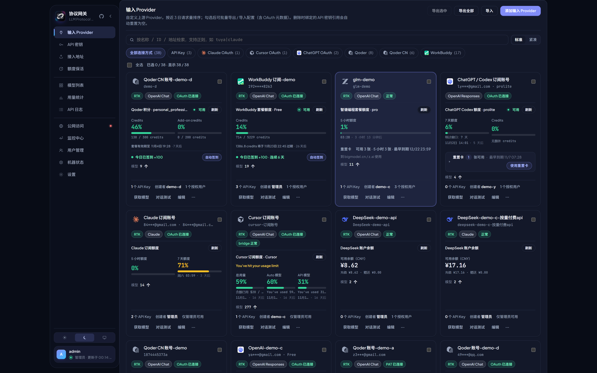
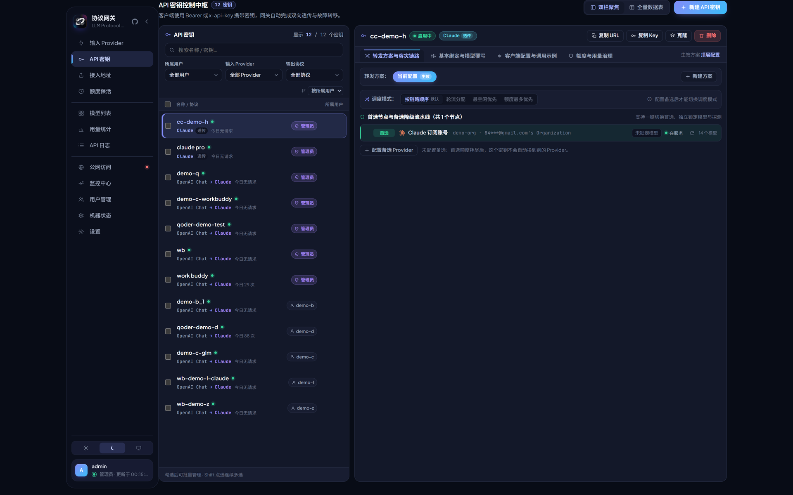
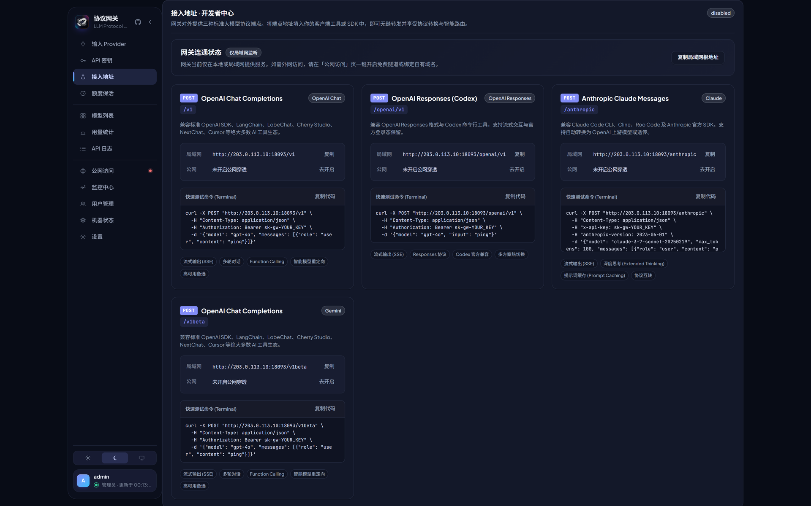
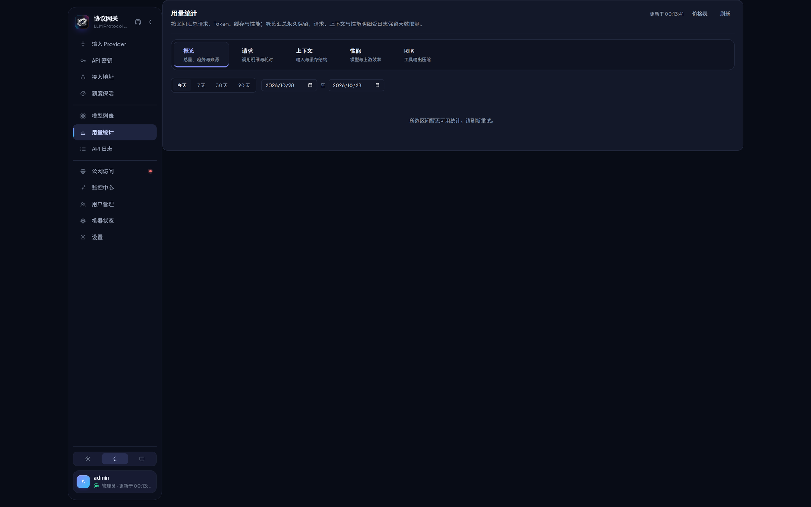
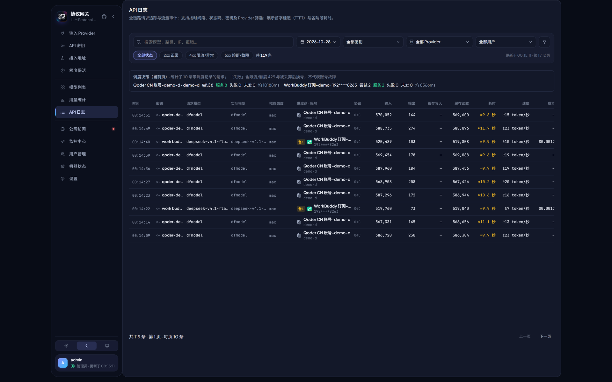
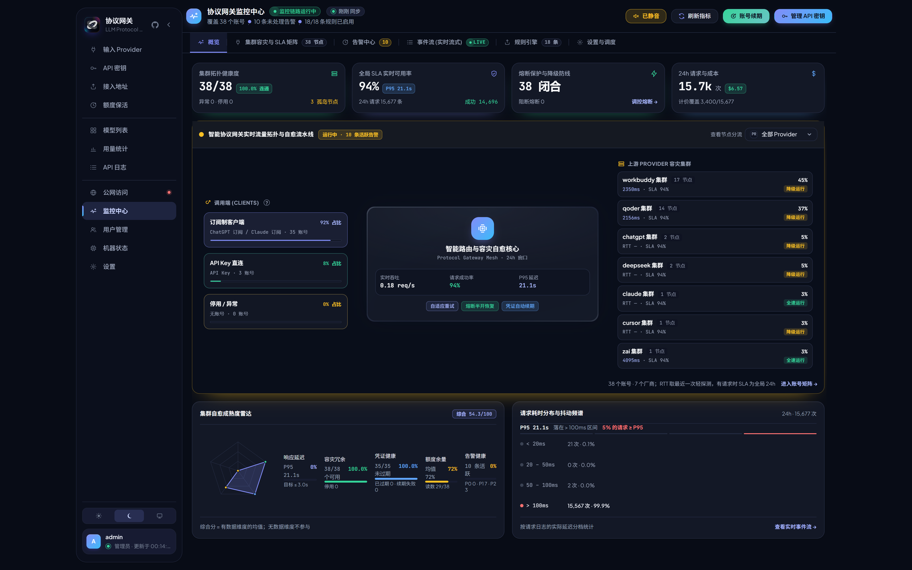
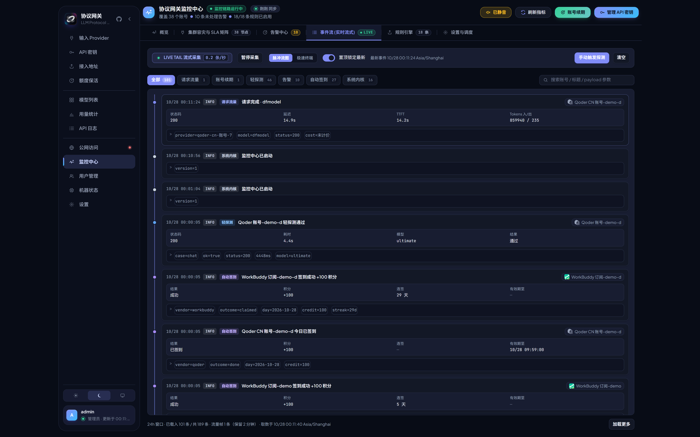
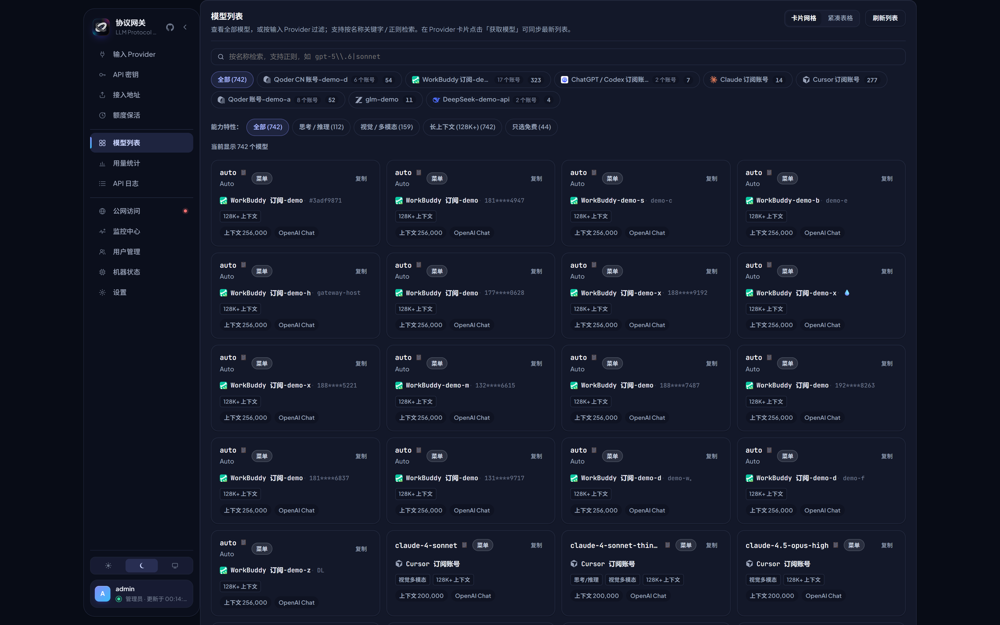

<p align="center">
  
</p>

<h1 align="center">LLM Protocol Gateway</h1>

<p align="center">
  把 <b>OpenAI Chat / OpenAI Responses / Claude / Gemini</b> 四种协议、<br>
  API Key、官方订阅、第三方中转，统一收敛成一个<b>可控、可观测、可容灾</b>的网关。
</p>

<p align="center">
  <a href="https://yangyongyongyong.github.io/llm-protocol-gateway/">介绍站</a> ·
  <a href="#-界面预览">界面预览</a> ·
  <a href="#-核心能力">核心能力</a> ·
  <a href="#-下载与安装">下载</a> ·
  <a href="#-快速开始">快速开始</a> ·
  <a href="#-部署">部署</a> ·
  <a href="#-文档">文档</a>
</p>

---

## 它解决什么问题

- **协议对不上**：客户端只会说 OpenAI Chat，上游只给 Claude / Gemini / Responses —— 网关做点对点直转，不经过有损中间层。
- **账号很分散**：官方 API Key、Claude/ChatGPT/Cursor 订阅、Qoder/Trae/ZCode/WorkBuddy 等账号，统一成同一套 Provider 与密钥体系。
- **总要手工切**：一个上游限流、封号、掉线，整条链路就断 —— 网关带备选链、冷却、回切探测与会话粘性。
- **花了多少说不清**：按模型配置价格表，逐请求记账到微美元，配合每密钥额度与用量分析，把成本和配额都摊在明面上。

一套 Go 核心，同一份前端，既可跑成 **Docker / K8s 服务**，也能打包成 **macOS 菜单栏 App**。

---

## 🖼️ 界面预览

> 截图取自真实运行的网关，账号邮箱、组织名、用户名、服务器地址等已做脱敏替换，请求量与金额保留原值。

### 输入 Provider：一个页面看清所有上游

卡片直接展示订阅额度、刷新时间、可用状态与失败原因；顶部可按连接方式筛选，勾选后可批量导出/导入（含 OAuth 凭据），也能对单个账号做模型同步、对话测试和签到。



### API 密钥：一个 Key，多套转发方案

同一个密钥可保存多套完整方案（首选 Provider、备选链、模型映射、思考深度），点选即时生效；右侧四个页签分别管理转发方案与容灾链路、绑定关系与模型覆写、客户端配置与调用示例、额度与用量治理。



### 接入地址：四种协议的端点与试跑命令

OpenAI Chat、OpenAI Responses、Claude、Gemini 四个端点集中展示，附局域网/公网地址和可直接粘贴的 `curl` 示例。



### 用量统计：请求、Token、缓存与成本

按区间统计请求数、Token、缓存命中率、首字延迟与往返耗时；成本卡片同时标注计价覆盖率，未计价的请求不会被写成 $0。



### API 日志：全链路逐请求追踪

记录密钥、请求/实际模型、推理强度、账号、协议、输入输出、缓存读写、耗时与成本；顶部给出当前页的调度决策摘要（尝试、失败、未发请求）。



### 监控中心：集群拓扑、SLA 与实时事件流

总览页把调用端构成、上游集群、SLA、请求分布与集群健康度放在一屏；账号矩阵、告警中心、事件流、规则引擎、调度设置分别成页。



事件流把请求、探测、自动签到、系统内核事件合成一条时间线，可按类型过滤，并保留原始 payload 便于复盘。



### 模型列表：所有模型一屏检索

汇总所有 Provider 的模型，支持按名称/正则搜索、按能力过滤（思考、视觉、长上下文、免费档），也能按 Provider 筛选和复制模型名。



---

## ⚙️ 核心能力

### 1. 四协议互转，12 条直转路径

| 入站 \ 出站 | OpenAI Chat | OpenAI Responses | Claude | Gemini |
| --- | --- | --- | --- | --- |
| **OpenAI Chat** | 透传 | 直转 | 直转 | 直转 |
| **OpenAI Responses** | 直转 | 透传 | 直转 | 直转 |
| **Claude** | 直转 | 直转 | 透传 | 直转 |
| **Gemini** | 直转 | 直转 | 直转 | 透传 |

- 协议相同直接透传，不同则点对点转换，**不经过有损中间层**；工具调用、图像输入、thinking 块与 prompt cache 断点在各条路径上都有测试覆盖。
- 流式响应支持**心跳保活**（长思考静默时不至于被客户端判定超时）、空响应重试、仅思考无正文时重试/切换。
- Claude 方向自动在工具尾块、system 尾块与倒数第二条 user 消息注入 `cache_control` 断点，保持上游 prompt 缓存命中。
- 除对话外，还透传 `/v1/embeddings`、`/v1/audio/transcriptions|translations`、`/v1/images/generations`。

### 2. 14 种接入方式，60 个常用预设

| 连接方式 | 说明 |
| --- | --- |
| API Key | 任意 OpenAI/Claude/Gemini 兼容上游、中转站或自建服务 |
| Bearer 自注册 | 本地/内网模型服务用 Provider 级令牌自动回填地址（`PATCH /__providers/{id}/self-register`） |
| Claude OAuth | Claude.ai 订阅账号，自动续期 + 缓存断点注入 |
| ChatGPT / Codex OAuth | ChatGPT 订阅账号，与 Codex CLI 同款登录 |
| Cursor OAuth | Cursor 订阅账号 |
| Qoder（国际版） | 浏览器设备码授权，或粘贴 `pt-` 个人访问令牌 |
| Qoder CN | qoder.cn 手机号账号，主机与账号与国际版不通用 |
| WorkBuddy / WorkBuddy AI | 腾讯 CodeBuddy 套餐的国内版与国际版（workbuddy.ai） |
| ZCode / ZCode BigModel | Z.ai / 智谱的 GLM Coding Plan，含重置卡展示与消费 |
| Trae CN / Trae Global | 字节 Trae 国内外版订阅，含免费档 |
| OpenCode Zen Free | Zen 免费模型无需密钥，填入密钥可同卡访问付费模型 |

添加 Provider 时提供 60 个预设（24 个厂商、16 个中转、12 个订阅、4 个本地），也可选「自定义」手填 Base URL。**密钥与 OAuth 令牌只留在网关进程里，任何页面都不会下发。**

### 3. 调度与容灾

- **四种调度模式**：按链路顺序、轮询、最空闲优先、额度最多优先。
- **会话粘性**：同一密钥 + 同一会话固定落在同一 Provider 上（30 分钟滑动窗口，最多 1 万个会话键），避免多账号轮换打断上下文。
- **冷却与回切**：软失败按梯度冷却，冷却期结束自动回切；异常账号的探测只走轻量请求，健康账号不产生额外流量。
- **限流闸门**：每个 Provider 可设最大并发、首包超时与 RPM，账号级 `LaneGroup` 把多个模型归并到同一配额池。
- **备选链**：首选 Provider 限流 / 5xx / 鉴权失败 / 连接错误时自动切下一个，并在日志里留下调度轨迹。

### 4. 成本账本与每密钥额度

- 价格表按模型维护输入、输出、缓存读、缓存写单价（USD / 百万 token），逐请求换算成微美元入库。
- 未配置价格的请求显示「未计价」并给出覆盖率，**绝不按 $0 记账**。
- 密钥可设置日 / 月额度：Token 上限、成本上限，请求前预扣、超限直接 429，避免单个调用方吃满账号。
- 单个 Provider 可开启 **RTK 工具输出压缩**（本机安装 `rtk` 后生效），减少上行 Token，节省量在用量页单独统计。

### 5. 观测与告警

- **API 日志 / 用量统计**：全链路耗时、TTFT、缓存命中、成本、流量。
- **监控中心**：集群容灾与 SLA 矩阵、轻量探测（chat + tools 两发、不消耗订阅额度）、事件流、18 条内置规则（可启停、改阈值）、静默窗口。
- **告警通道**：飞书、钉钉、企业微信、Telegram，可按严重级别过滤。
- **机器状态**：CPU（整机 + 逐核）、负载、内存构成、挂载卷、磁盘吞吐、网卡收发、网关卡顿相关的进程指标（RSS / 线程 / 句柄 / goroutine），加上近 60 分钟趋势图；「诊断」给出带处置建议的体检结论，「诊断包」导出含 GC 与数据库信息的 JSON，便于附在问题反馈里。Linux 走 `/proc`，macOS / Windows 走 gopsutil（系统计数器），三个平台启动即可用。网关自身常驻采样（有人在看 3 秒一档、无人看降到 15 秒）并通过 SSE 推送，样本保留 24 小时，所以曲线在页面关着、网关重启后依然连续。

### 6. 运维能力

- **公网访问**：Cloudflare 快速隧道零配置对外，也可绑定自有域名；API 与 UI 可分别使用不同域名，并互相屏蔽对方的路由。
- **额度保活**：按「每天定点 / 每 N 小时 / 每 N 分钟」定时发一条极短探测，把订阅额度窗口钉在固定时刻，支持静默时段。
- **每日签到**：Qoder 两站与 WorkBuddy 国内版的积分活动可托管，按北京时间划分日期，失败自动重试。
- **用户与角色**：管理员可用全部 Provider；普通用户只看到输入 Provider、模型列表、API 密钥、API 日志、用量统计、额度保活六个页面，且只能操作自己的数据。
- **登录**：远程首次访问需设置管理员密码，本机 `127.0.0.1` 直连免密（SSH 端口转发同样可用）。

---

## 📥 下载与安装

预编译产物由 [Release 工作流](.github/workflows/release.yml) 在 `v*` tag 上构建，
在 [Releases](https://github.com/yangyongyongyong/llm-protocol-gateway/releases) 下载，
每个版本附带 `SHA256SUMS`。介绍站 <https://yangyongyongyong.github.io/llm-protocol-gateway/>
会读取最新 Release 并自动填充下载链接。

### 桌面 App（带界面）

| 平台 | 产物 | 说明 |
| --- | --- | --- |
| macOS 11+ | `llm-protocol-gateway-desktop-darwin-arm64.dmg` / `-amd64.dmg`（另有 `.zip`） | 挂载后把 App 拖进 Applications；未公证，首次打开请右键 →「打开」 |
| Windows 10/11 | `llm-protocol-gateway-desktop-windows-amd64.exe` | 未签名，SmartScreen 提示时选「更多信息 → 仍要运行」 |
| Linux x86_64 | `llm-protocol-gateway-desktop-linux-amd64.AppImage` / `.deb` | 需要 GTK3 与 WebKitGTK 4.0/4.1 |

macOS 也可以一条命令安装到 `/Applications`：

```bash
curl -fsSL https://raw.githubusercontent.com/yangyongyongyong/llm-protocol-gateway/main/scripts/install-macos.sh | bash
```

### 无界面服务（gateway + web-dist）

| 系统 | 架构 | 产物 |
| --- | --- | --- |
| Linux | amd64 / arm64 / armv7 | `llm-protocol-gateway_<版本>_linux_<架构>.tar.gz` |
| macOS | arm64 / amd64 | `llm-protocol-gateway_<版本>_darwin_<架构>.tar.gz` |
| Windows | amd64 / arm64 | `llm-protocol-gateway_<版本>_windows_<架构>.zip` |

压缩包内 `gateway` 与 `web-dist/` 必须保持同级，用包内的 `start.sh` / `start.cmd` 启动
（脚本会设置 `GATEWAY_WEB_DIST`，直接运行二进制打不开控制台）。本地出包：

```bash
bash scripts/release.sh package 0.4.0          # 默认全部 7 个平台到 dist/ + SHA256SUMS
bash scripts/release.sh package 0.4.0 linux/amd64 windows/amd64
bash scripts/release.sh desktop 0.4.0 windows/amd64   # Windows 桌面 exe（含图标与版本资源）
```

---

## 🚀 快速开始

```bash
cd web
npm install
npm run dev        # 编译网关 + 必要时的 web/dist，启动看护进程与 Vite
```

- 开发界面：`http://127.0.0.1:5173`（Vite HMR）
- 网关 API / 管理页：`http://127.0.0.1:18093`

只起后端：

```bash
go run ./cmd/gateway
GATEWAY_ADDR=127.0.0.1:18090 go run ./cmd/gateway   # 自定义端口
```

> 只跑 `go run ./cmd/gateway` 时，管理页依赖仓库内的 `web/dist`；先 `cd web && npm run build`，或改用 `npm run dev`。

常用校验与构建：

```bash
go build ./... && go test ./...   # 编译 + 全量测试
cd web && npm run build           # tsc -b && vite build
cd web && npm run verify          # 健康检查网关与 Vite 代理
```

本地状态默认存放在用户配置目录（macOS 为 `~/Library/Application Support/llm-protocol-gateway/`，Linux 为 `~/.config/llm-protocol-gateway/`），可用 `GATEWAY_DB` 指定 SQLite 位置。

---

## 📦 部署

### Docker / Compose / Kubernetes

镜像已发布到 Docker Hub（`linux/amd64` + `linux/arm64`）：[`yangyongyong/llm-protocol-gateway`](https://hub.docker.com/r/yangyongyong/llm-protocol-gateway)

```bash
docker run -d --name llm-protocol-gateway \
  -p 18093:18093 \
  -v llm-gateway-data:/data \
  --restart unless-stopped \
  yangyongyong/llm-protocol-gateway:latest

curl -s http://127.0.0.1:18093/__health
```

- 仓库根目录的 `docker-compose.yml`：`docker compose up -d`
- Kubernetes：`deploy/k8s.yaml`（Namespace + PVC + Deployment + Service + `/__health` 探针，单副本）
- 完整说明（环境变量、发布流程、持久化）见 **[容器部署](docs/deploy.md)**
- 无 Docker 的服务器可参考 **[裸机部署（systemd）](docs/deploy-linux-bare-metal.md)**

### 桌面 App

Wails 打包的桌面应用覆盖 macOS / Windows / Linux，内置同一套核心与 `web/dist`，关闭窗口后继续在后台运行；
macOS 版内置 `cloudflared`，可直接开启 Cloudflare 公网访问。预编译包见上方的「下载与安装」，
macOS 本地构建与使用细节见 **[macOS App](docs/macos-app.md)**。

```bash
bash scripts/build-macos-app.sh                      # macOS
bash scripts/release.sh desktop 0.4.0 windows/amd64  # Windows（交叉编译）
bash scripts/package-desktop-linux.sh                # Linux AppImage / deb
```

---

## 🧭 控制台导航

| 分组 | 页面 |
| --- | --- |
| 核心配置 | 输入 Provider · API 密钥 · 接入地址 · 额度保活 |
| 数据洞察 | 模型列表 · 用量统计 · API 日志 |
| 系统管理 | 公网访问 · 监控中心 · 用户管理 · 机器状态 · 设置 |

---

## 📚 文档

- [Bearer 令牌 Provider](docs/bearer-provider.md) —— 配置、鉴权、健康探测、故障转移、自注册
- [容器部署（Docker / Compose / K8s）](docs/deploy.md)
- [Linux 裸机部署（systemd）](docs/deploy-linux-bare-metal.md)
- [macOS App](docs/macos-app.md)
- [已知问题 / 踩坑记录](docs/known-issues.md)

---

## 🔌 验证接口

```bash
curl http://127.0.0.1:18093/__health
curl http://127.0.0.1:18093/__state
curl http://127.0.0.1:18093/v1/models

curl -s http://127.0.0.1:18093/v1/chat/completions \
  -H 'Content-Type: application/json' \
  -H "Authorization: Bearer $GATEWAY_API_KEY" \
  -d '{"model":"gpt-5.5","messages":[{"role":"user","content":"hi"}]}'
```

---

## 🔒 安全说明

- API Key、OAuth 令牌、Tunnel Token 只在网关进程内使用，不会出现在 `/__state`、管理接口或前端页面中。
- 远程访问必须通过管理员密码登录；只有本机 loopback 请求才享受免密。
- 上游凭证、请求/响应正文与日志均存放在本地 SQLite，请自行做好磁盘与备份的访问控制。
- 截图与文档不得包含真实密钥、账号邮箱或服务器地址。
